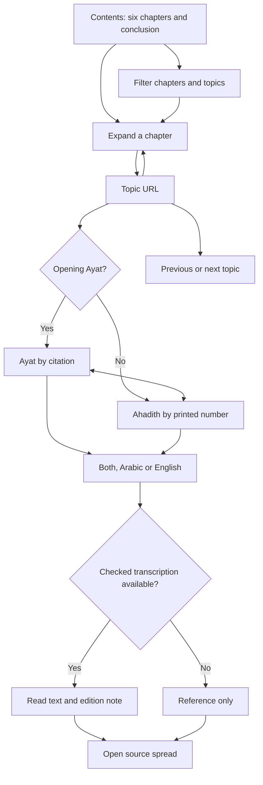

# Muntakhab Reading Room · UX findings

**Goal:** Open the printed collection at the right topic, distinguish Ayat from Ahadith, and check either against the original scan. This is a React prototype informed by the installed skills, not a user study or a finished publication.

| Finding | Prototype decision |
| --- | --- |
| The printed hierarchy is already a useful mental model. | Keep the six main chapters in book order, followed by the separately labeled concluding section. Expand chapters in place; give each of the 29 topics a stable URL. |
| Readers may arrive with a topic name but not its chapter. | Provide a chapter/topic filter, open matching chapters, keep book order, and make clearing the filter easy. Don’t imply that this searches the text of the book. |
| The choice of *what* to read is different from the choice of *language*. | Use two separate controls: **Ayat / Ahadith** and **Both / Arabic / English**. Show Arabic right-to-left above the translation in bilingual mode. Keep the language choice for this browser session. |
| A verse count is not a list of passage cards. | Use the edition’s ayat and numbered-hadith totals on the contents page. In the reader, separately show the number of passage cards. Label partial verses as excerpts and don’t count quotations nested in hadith as standalone Ayat. |
| OCR can introduce errors or attach a translation to the wrong entry. | Keep unreviewed words out of the reader. Show a reading preview notice and reference-only states; distinguish exact checked page spans from approximate OCR-located scan links. |
| Some readers will work through the book continuously and others will jump in. | Include previous/next topics, a contents/chapter breadcrumb, and an original scan link. Start with at most 12 cards per category and make the rest available on demand. |

## Navigation and reading flow

## Screen inventory

| Screen | Main action | Recovery and edge states |
| --- | --- | --- |
| Contents · `#/` | Expand a chapter and select a topic. | First chapter open by default; multiple chapters can be open; filtering has a visible match count and a no-results state. |
| Topic · `#/read/:chapter/:topic` | Select a reading type and language, then read or open the scan. | Zero-Ayat topics open on Ahadith; direct entry links work with `?entry=...`; missing language/text, failed snapshot load, source links, and long lists have separate states. |
| About · `#/edition` | Identify the scan, translation, and book credits. | Direct PDF, flipbook, and printed Contents links. Printed pages and PDF indexes are not interchangeable. |
| Invalid link | Return to contents. | Dedicated not-found screen, rather than a blank reader. |

## Accessibility and layout decisions

- Use native disclosure buttons (`aria-expanded` / `aria-controls`), semantic headings, and real route links. The two reading controls are named button groups with `aria-pressed`, not ARIA tabs without tab keyboard behavior.
- Use visible focus, a skip link, routes that focus the new main content, and focus on the chapter button on return by breadcrumb. New entries can be reached without returning to the top of the topic.
- Preserve comfortable line heights and right-to-left Arabic (`lang="ar"`, `dir="rtl"`) on small screens. Large layouts have a guide rail; small layouts retain the inline reading controls. No generated Arabic text appears in decorative art.
- Use ink green, warm paper, serif reading type, and a muted supporting rail. Support reduced motion; combine color with button state or explicit text. Fonts are self-hosted.

## Skills consulted

- **Information Architecture** (Rampstack, `e5bc675`): book tree, labels that match the edition, chapter breadcrumbs, explicit printed-page vs. scan locators.
- **UX Flow Planner** (Rich Hemsley, `1185d0d`): entry/exit paths, screen inventory and edge states, flow diagram.
- **UI/UX Pro Max** (`7436a6e`): editorial reading layout, warm palette, visible focus, keyboard behavior and responsive React components. A suggested marketing hero/testimonials flow was not used; navigation and reading are the tasks here.

## What to validate with readers next

1. Ask readers to find Wudu under *Salah*, then switch to Hadith 243 and check its source. Watch whether they can distinguish the exact scan link from an approximate locator.
2. Start at an Iman deep link on mobile and check whether bilingual stacking or a single-language default is easier to read. Include Arabic-first and keyboard/screen-reader sessions.
3. Ask someone to find both printed Hadith #1 entries in *‘Ilm and Dhikr*. Confirm chapter/topic context and the original scan are enough to distinguish the numbering restart.
4. Test when “Reference only” is helpful versus frustrating. Decide whether to prioritize review by frequently visited topics, or finish a whole chapter before expanding the reading preview.

Full transcription review, search inside the book text, user accounts and production database integration are outside this prototype.
